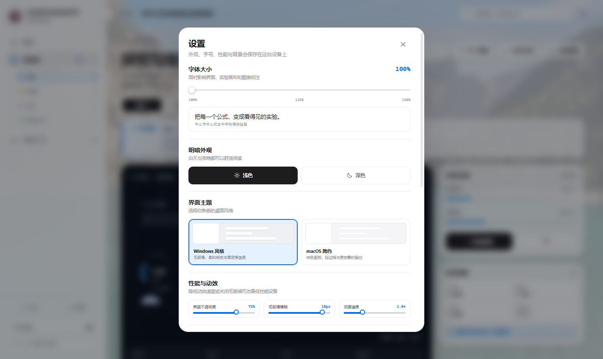

# 中山市中山纪念中学物理实验室

[中文](#zh) · [English](#en)

> **v0.6.1** · 22 个高中物理实验 · 统一字体层级 · 无文字大缩略图 · Bing 壁纸 · 性能优化
>
> 22 high-school physics experiments · unified type scale · clean thumbnails · Bing wallpapers · performance tuning

[](#)
[](#)
[](LICENSE)
[](#)




---

<a id="zh"></a>
# 中文

## 简介

Prism（中山市中山纪念中学物理实验室）是一个面向高中物理的交互式实验平台。它把 **22 个高中物理基本实验** 做成可拖动、可采集数据、可生成图像的模拟器，并使用 Apple 风格的界面、深色实验舞台、实时读数与动画来呈现抽象的物理过程。

项目完全由 **HTML + CSS + JavaScript** 编写，不依赖后端、不需要安装 Node.js 或编译工具，双击即可运行。无需动态链接库，也不依赖外部 CDN。

- 产品需求文档：[PRD.md](PRD.md)
- 0.6.1 新增：统一字体层级、无文字大缩略图、细腻滚动条、渲染性能优化、Bing 每日壁纸与系统壁纸 API 自动查找
- 0.6.0 新增：性能与动效设置、毛玻璃、动画速度、内置/上传/联网/桌面 API 背景、抽屉式侧边栏、真实实验缩略图、关于页、PPT / WPS 联动

## 快速启动

### 方式一：双击启动（推荐）

双击项目根目录的 **`start.bat`**。它会：

1. 在 `127.0.0.1:4178` 启动一个轻量本地静态服务器；
2. 用 Chrome / Edge 的 **应用窗口模式** 打开实验室；
3. 关闭命令行窗口或按 `Ctrl + C` 停止服务。

> 如果 Chrome / Edge 不在默认路径，脚本会自动尝试系统默认浏览器。

### 方式二：在 VS Code 中启动

1. 用 VS Code 打开本文件夹（或双击 `prism-physics-lab.code-workspace`）；
2. 按 `Ctrl + Shift + B`，或运行任务 **“Prism: 启动实验室”**；
3. 浏览器会自动打开 `http://127.0.0.1:4178/`。

### 方式三：直接打开

直接双击 `index.html` 也能运行。由于浏览器对本地文件的存储策略不同，建议使用前两种方式以获得更稳定的学习进度记录。

### 方式四：便携 EXE（分享给其他人）

**`dist/PrismLab-0.6.1.exe`** 是单文件便携版，适用于 Windows 10 / 11：

1. 把 exe 复制到任意目录，双击运行；
2. 程序内置全部 HTML / CSS / JavaScript，不需要联网、不需要安装；
3. 自动尝试用 Chrome / Edge 的应用窗口打开，若未安装则交给默认浏览器；
4. 关闭浏览器后服务仍在系统托盘，右键 Prism 图标可重新打开或退出。

由于是未签名程序，Windows SmartScreen 可能提示“未知发布者”，选择“更多信息 → 仍要运行”即可。

重新构建便携版：

```powershell
powershell -ExecutionPolicy Bypass -File packaging\build-exe.ps1
```

构建脚本会压缩 Web 资源、嵌入图标和版本信息，输出到 `dist/`。

## 设置、字体与页面滚动

- 点击顶部右侧的 **齿轮按钮** 打开独立设置面板。
- **字体大小** 使用滑块调节，支持 **100%–150%**，同时作用于界面正文、实验读数、Canvas 画布标注和图表坐标轴文字，并自动保存。
- **明暗外观** 可切换浅色 / 深色；**界面主题** 可在 **Windows 风格**（默认）与 **macOS 简约** 之间选择。
- 首次打开软件时会显示 **Welcome** 向导，询问字体大小、明暗外观和主题偏好；之后可在设置中随时修改或重新查看。
- 页面主体支持鼠标滚轮上下滚动；鼠标位于侧边栏、画布或图表上时也可以滚动主内容。数据表内部滚动时优先滚动表格。
- 切换实验时会自动回到页面顶部，避免上一个实验的滚动位置遮挡新页面。

## 功能总览

- **22 个高中物理实验**：力学 10 个、电磁学 8 个、光学 2 个、热学与分子 2 个。
- **多实验方案**：匀变速、平行四边形、平抛、向心力、机械能、动量、单摆提供“方案一 / 方案二”切换 dock，切换带滑动背景与内容淡入动画。
- **实验内容对齐**：按《实验总结》补齐实验原理、步骤、数据处理与注意事项；新增“探究等温条件下气体压强与体积的关系”。
- **实时模拟**：Canvas 60fps 动画，可播放、暂停、重置、全屏、截图。
- **实时图像**：每个实验都有对应的物理量图像，如 v–t、F–x、a–F、U–I、T²–L、sin i–sin r 等。
- **数据探究**：调节变量 → 采集数据 → 自动生成散点、拟合线与数据表 → 导出 CSV。
- **实验向导**：步骤可勾选，结论随数据动态更新。
- **连续运动**：运动学实验播放后会持续循环，不会自动停止；播放中调节变量会从当前状态平滑过渡，不会重新开始。
- **快速切换**：实验页右上角提供上一个 / 下一个实验按钮，支持首尾循环。
- **侧边栏收起**：左侧圆形按钮可平滑收起 / 展开侧边栏，收起后获得更大的实验视野。
- **界面精简**：实验库移除重复的四大学科板块卡片；移除顶部专注模式按钮和左下角用户标志。
- **简易 / 复杂步骤**：实验 02 可切换两套实验步骤，兼顾快速理解与完整操作训练。
- **误差分析**：实验 11–14 提供“误差分析”按钮，展示电表内阻、接法与测量值偏大/偏小的关系及修正公式。
- **教材分类**：保留力学 / 电磁学 / 光学 / 热学与分子分类，同时增加粤教版必修一、必修二、必修三、选必一、选必二、选必三筛选。
- **电学 / 光学交互面板**：电路图、电表、变压器、双缝干涉、折射光路等以完整交互面板模拟。
- **多用电表接线互动**：7 种待测元件可选；拖动红黑表笔接触元件两端后才会显示读数，支持断线、错接和换挡提示。
- **抽象过程动画**：油膜铺展与单分子层、电磁感应、频闪轨迹、能量转化等。
- **创意工坊**：函数实验模式 + **模块化搭建模式**；可拖入小车、斜面、小球、弹簧、电源、电阻、灯泡、电表、光源、透镜、注射器等器具，自由摆放并连线，运行、保存和导出模块实验。
- **开放接口**：通过 `OL.registerExperiment()` / `OL.registerPlugin()` 用 JavaScript 扩展新实验。
- **本地档案**：学习进度、实验步骤、自定义实验保存在 `localStorage`。
- **深色模式**、响应式布局、键盘快捷键、全局实验搜索。
- **字体与主题**：齿轮设置支持 100%–150% 字体滑块、浅色 / 深色、Windows / macOS 主题，并保存到本地。
- **性能与背景**：左下角设置提供界面不透明度、毛玻璃 0–20 px、动画速度、6 张内置自然/科学背景、图片上传、Bing 每日壁纸/联网搜索、系统壁纸 API 自动发现。
- **真实实验缩略图**：实验卡片使用对应实验舞台截图，取消缩略图上的重复文字，图片放大到 176px；悬停时在上方显示更大的实验预览。
- **统一字体层级**：100%–150% 缩放使用统一字号阶梯，标题、正文、辅助文字保持清晰层级。
- **细腻滚动条**：设置、About 许可证与主页面使用低对比度细滚动条，不再抢占视觉焦点。
- **渲染优化**：减少卡片毛玻璃合成层，Canvas 平滑设置只在尺寸变化时更新，后台标签页暂停实验帧。
- **抽屉式侧边栏**：收起时侧边栏以固定宽度整体推入，徽标和文字不缩放；实验库下的学科分类会随进入/离开实验库展开和收起。
- **关于页**：左下角“关于”在右侧主区域展示版本、最近更新、GitHub Issues 递交入口、完整 BSD 3-Clause 许可证与 PPT / WPS 联动说明。
- **PPT / WPS 联动**：拖动实验卡片到 PowerPoint 或 WPS 幻灯片生成实验链接；放映时点击链接即可打开对应实验；实验页也提供「PPT 链接」复制按钮。
- **品牌更新**：更名为“中山市中山纪念中学物理实验室”，使用学校校徽作为应用图标。

## 22 个实验

| # | 实验 | 领域 | 核心图像 / 交互 |
|---|------|------|-----------------|
| 01 | 探究匀变速直线运动的规律 | 力学 | 纸带点迹 / 光电门、v–t 图像 |
| 02 | 探究弹力与形变量的关系 | 力学 | F–x 图像、胡克定律 |
| 03 | 验证力的平行四边形定则 | 力学 | 矢量合成 / 钩码同心圆、合力随夹角变化 |
| 04 | 探究加速度与合外力、质量的关系 | 力学 | a–F、a–1/m 控制变量 |
| 05 | 探究平抛运动的规律 | 力学 | 频闪轨迹 / 分运动、运动分解 |
| 06 | 探究向心力大小的影响因素 | 力学 | F–r、F–ω² 图像 |
| 07 | 探究功与速度变化的关系 | 力学 | W–v² 图像、动能定理 |
| 08 | 验证机械能守恒定律 | 力学 | 单个物体 / 系统、动能 / 势能 / 总能量曲线 |
| 09 | 验证动量守恒定律 | 力学 | 气垫导轨 / 斜槽小球、碰撞前后 p–t 曲线 |
| 10 | 利用单摆测重力加速度 | 力学 | T²–L 图像、周期测量 |
| 11 | 测量金属丝的电阻率 | 电磁学 | 伏安法、U–I 图像 |
| 12 | 描绘小灯泡的伏安特性曲线 | 电磁学 | 非线性 I–U 曲线、灯丝温升 |
| 13 | 测量电源电动势和内阻 | 电磁学 | U–I 截距与斜率 |
| 14 | 练习使用多用电表 | 电磁学 | 挡位、量程、表盘读数 |
| 15 | 探究安培力的大小 | 电磁学 | F–I 图像、左手定则 |
| 16 | 探究电磁感应的产生条件 | 电磁学 | 磁铁运动、电流计指针 |
| 17 | 探究变压器电压与匝数的关系 | 电磁学 | U₂–n₂ 图像、交流波形 |
| 18 | 探究平行板电容器的电容 | 电磁学 | C–d、C–S 图像、电场线 |
| 19 | “插针法”测量玻璃砖的折射率 | 光学 | sin i–sin r 图像、光路与插针 |
| 20 | 利用双缝干涉测定光的波长 | 光学 | 干涉条纹、强度分布 |
| 21 | “油膜法”测油酸分子直径 | 热学与分子 | 油膜铺展动画、单分子层 |
| 22 | 探究等温条件下气体压强与体积的关系 | 热学与分子 | 注射器、压力表、p–V / p–1/V |

## 多方案实验

下列实验在标题下方显示 **方案一 / 方案二** dock：

| 实验 | 方案一 | 方案二 |
|------|--------|--------|
| 01 匀变速 | 打点计时器 | 光电门 |
| 03 力的合成 | 弹簧测力计 | 钩码 |
| 05 平抛 | 频闪照相 | 分运动研究 |
| 06 向心力 | 向心力演示仪 | 光电门 |
| 08 机械能 | 单个物体 | 系统 |
| 09 动量 | 气垫导轨 | 斜槽小球 |
| 10 单摆 | 计算法 | 图像法 |

切换方案会同步更新公式、原理、步骤与舞台标记，不重置实验时间、参数或已采集数据。

## 创意工坊

### 函数实验

打开左侧 **创意工坊**，填写：

- 实验名称、简介、主题色；
- 函数表达式，例如 `a * sin(t) + b`；
- 自变量 `t` 的范围与步长；
- 参数 `a`、`b` 的名称、范围与单位；
- 纵轴名称与单位。

右侧会实时预览函数曲线。点击 **“创建并打开实验”** 后，会生成一个完整的实验页，包含变量滑块、实时读数、图像、数据表与实验向导。

支持的表达式：

```text
+  -  *  /  ^  ( )
sin cos tan asin acos atan
sqrt abs exp ln log log2
floor ceil round min max pow
sind cosd tand          # 角度制三角函数
pi e tau
```

### 模块搭建

切换到 **模块搭建**，从左侧拖入实验器具：

- 运动：小车、斜面、小球、弹簧、摆球
- 电学：电源、电阻、小灯泡、开关、电流表、电压表
- 光学：光源、透镜、光屏
- 热学：注射器、水槽

支持自由摆放、拖动、修改名称和参数、连线、运行、停止、保存、载入和导出模块 JSON。连线模式会依次点击两个器具建立连接；保存的模块实验出现在“我的模块实验”中。

### 导入 / 导出

- **导出全部**：生成 `prism-custom-experiments.json`；
- **导入 JSON**：支持单个对象、数组或 `{ "experiments": [...] }`；
- 也可直接加载本地 `.js` 插件文件。

## 开放实验接口

在页面加载后，可以通过全局对象 `OL` 注册新实验。

### 1. 注册一个完整实验

```js
OL.registerExperiment({
  id: 'damped-oscillation',
  title: '阻尼振动',
  description: '观察振幅随时间的衰减。',
  formula: 'x = A e^(-γt) cos(ωt)',
  accent: '#5e5ce6',
  controls: [
    { key: 'A', label: '初始振幅 A', min: 0.1, max: 5, step: 0.1, value: 2, unit: 'cm', decimals: 2 },
    { key: 'gamma', label: '阻尼系数 γ', min: 0, max: 1, step: 0.01, value: 0.1, unit: '', decimals: 2 },
    { key: 'omega', label: '角频率 ω', min: 0.5, max: 5, step: 0.1, value: 2, unit: 'rad/s', decimals: 1 }
  ],
  lab: {
    draw(ctx, w, h, state, view) {
      // 使用 Canvas 2D 绘制实验场景
    },
    readouts(state) {
      return [
        { label: '位移 x', value: '1.20', unit: 'cm' },
        { label: '振幅 A', value: '2.00', unit: 'cm' }
      ];
    },
    plot(state, view) {
      return {
        xLabel: '时间 t', yLabel: '位移 x', xUnit: 's', yUnit: 'cm',
        series: [{ name: 'x–t', color: '#5e5ce6', points: [{ x: 0, y: 2 }, { x: 1, y: 1 }] }]
      };
    },
    sample(state) {
      return { t: 0, x: 1.2 };
    },
    columns: [
      { key: 't', label: 't', unit: 's', decimals: 2 },
      { key: 'x', label: 'x', unit: 'cm', decimals: 2 }
    ],
    conclusion(state) {
      return '<b>结论：</b>振幅随时间指数衰减。';
    }
  }
});
```

`lab` 对象可实现的钩子：

| 钩子 | 说明 |
|------|------|
| `init(state, view)` | 初始化内部状态 |
| `onControl(key, state, view)` | 变量改变时调用 |
| `step(state, dt, view)` | 播放时每帧更新物理状态 |
| `draw(ctx, w, h, state, view)` | 绘制实验舞台，坐标为 CSS 像素 |
| `readouts(state, view)` | 返回 `{label, value, unit}` 数组 |
| `sample(state, view)` | 返回一行数据，供数据表与 CSV 使用 |
| `columns` | 数据表列定义 |
| `plot(state, view)` | 返回 `{xLabel, yLabel, xUnit, yUnit, series}` |
| `conclusion(state, view)` | 返回结论 HTML |

`view` 提供：

```js
view.t         // 播放时间
view.playing   // 是否正在播放
view.records   // 已采集的数据
```

### 2. 批量注册插件

```js
OL.registerPlugin({
  name: '我的实验包',
  version: '1.0.0',
  experiments: [ /* 多个 OL.registerExperiment 配置 */ ]
});
```

### 3. 公式型实验

```js
OL.workshop.add({
  name: '平方反比关系',
  description: '验证 y 与 t² 的关系。',
  expression: 'a / (t^2 + b)',
  yLabel: '强度', yUnit: 'lx',
  tLabel: '距离', tUnit: 'm',
  tMin: 0.5, tMax: 5, tStep: 0.01, tValue: 2,
  aLabel: '系数 a', aMin: 0.1, aMax: 10, aStep: 0.1, aValue: 5, aUnit: '',
  bLabel: '偏移 b', bMin: 0, bMax: 3, bStep: 0.1, bValue: 0.5, bUnit: '',
  accent: '#0a84ff'
});
```

## 项目结构

```text
prism-physics-lab/
├─ index.html                    # 应用外壳
├─ start.bat                     # 一键启动
├─ run.ps1                       # 本地静态服务器 + 浏览器启动
├─ assets/
│  ├─ css/
│  │  └─ styles.css              # Apple 风格设计系统、响应式布局
│  └─ js/
│     ├─ data.js                 # 22 个实验元数据、方案、步骤、控件
│     ├─ app.js                  # 路由、仪表盘、实验运行时
│     ├─ workshop.js             # 创意工坊 + 模块搭建
│     ├─ plugin-api.js           # 开放实验接口
│     ├─ core/
│     │  ├─ utils.js             # 工具、Canvas 绘图助手、本地存储
│     │  ├─ chart.js             # 交互式 Canvas 图表引擎
│     │  └─ expr.js              # 安全表达式编译器（工坊用）
│     └─ labs/
│        ├─ common.js            # 实验公共绘图能力
│        ├─ mechanics-a.js       # 01–05
│        ├─ mechanics-b.js       # 06–10
│        ├─ electricity-a.js     # 11–14
│        ├─ electricity-b.js     # 15–18
│        └─ optics-molecular.js  # 19–22
└─ .vscode/                      # 推荐扩展与启动任务
```

## 键盘快捷键

| 快捷键 | 功能 |
|--------|------|
| `⌘ / Ctrl + K` | 全局搜索实验 |
| `Space` | 播放 / 暂停当前实验 |
| `R` | 重置实验 |
| `F` | 全屏实验舞台 |
| `Esc` | 关闭弹窗 / 搜索 |

## 设计说明与教学边界

为了在浏览器中保持流畅与可交互，部分实验采用教学化近似模型：

- 小灯泡的 `I–U` 曲线使用随电压升温的电阻模型，用于呈现“非线性”趋势；
- 变压器按理想变压器处理，忽略漏磁、铜损与铁损；
- 油膜法把油酸膜视为理想单分子层，面积由用户给定或由动画示意；
- 平抛、单摆、碰撞等实验采用高中阶段的标准理想模型，重力加速度可调节；
- 电磁感应图像使用磁通量变化率模型，用于定性/半定量观察。

这些近似不影响实验的核心物理规律与图像趋势，但不应作为精密测量数据使用。

## 浏览器支持

- Chrome / Edge 96+
- Safari 16+
- Firefox 110+

使用了 `Canvas 2D`、`ResizeObserver`、`backdrop-filter` 与 `localStorage`。不支持 `backdrop-filter` 的浏览器会自动退化为普通半透明面板。

## License

本项目采用 **BSD 3-Clause License**，完整条款见 [LICENSE](LICENSE)。可自由用于课堂、社团与个人学习，但再分发时需保留版权声明、许可证条款和免责声明，且不得未经许可使用作者名义为衍生作品背书。

第三方字体与图标主要使用系统字体 / 内联 SVG；LaTeX 公式渲染使用本地打包的 **KaTeX 0.16.22**，其许可证为 **MIT License**（见 `assets/vendor/katex/LICENSE`），不依赖 CDN。

---

<a id="en"></a>
# English

## Overview

The Sun Yat-sen Memorial Secondary School Physics Lab (Prism) is an interactive physics lab for high-school students. It turns **22 core high-school physics experiments** into draggable, data-collecting, graph-generating simulators, presented through an Apple-inspired interface, a dark experiment stage, live readouts, and motion.

The project is written entirely in **HTML + CSS + JavaScript**. It has no backend, no build step, and no runtime CDN dependency. Open it directly or run the bundled local server.

- Product requirements: [PRD.md](PRD.md) (Chinese)
- New in 0.6.1: unified typography, larger text-free thumbnails, subtle scrollbars, render-performance tuning, Bing daily wallpapers and automatic system wallpaper API discovery.
- New in 0.6.0: performance controls, glass blur, animation speed, built-in/uploaded/online/desktop-API backgrounds, drawer sidebar, real experiment thumbnails, About page, and PowerPoint / WPS linking.

## Quick start

### 1. Double-click `start.bat` (recommended)

The script:

1. starts a lightweight static server at `127.0.0.1:4178`;
2. opens the lab in a Chrome / Edge app window;
3. stops when you close the terminal or press `Ctrl + C`.

If Chrome / Edge is not found, the script falls back to the system default browser.

### 2. VS Code

1. Open this folder (or `prism-physics-lab.code-workspace`) in VS Code;
2. press `Ctrl + Shift + B`, or run **“Prism: 启动实验室”**;
3. the browser opens `http://127.0.0.1:4178/`.

### 3. Open `index.html`

You can double-click `index.html` directly. For stable local progress storage, prefer the local server methods above.

### 4. Portable EXE (Windows 10/11)

**`dist/PrismLab-0.6.1.exe`** is a single-file portable build:

1. copy it anywhere and double-click;
2. all HTML / CSS / JavaScript is embedded; no network or installer required;
3. it tries Chrome / Edge app mode, then falls back to the default browser;
4. after closing the browser, the server stays in the system tray; right-click the Prism icon to reopen or exit.

The executable is unsigned, so Windows SmartScreen may warn about an unknown publisher. Choose **More info → Run anyway**.

Rebuild the portable EXE:

```powershell
powershell -ExecutionPolicy Bypass -File packaging\build-exe.ps1
```

## Settings, font size and scrolling

- Click the **gear** button at the top right to open the settings panel.
- **Font size**: 100%–150%; affects UI text, experiment readouts, Canvas labels and chart axes, and is saved automatically.
- **Appearance**: light / dark; **UI style**: Windows (default) or macOS minimal.
- The first launch shows a **Welcome** guide for font size, appearance and UI style. It can be reopened from Settings.
- The page, lab stage and charts support mouse-wheel scrolling. Tables scroll internally when needed.
- Switching experiments scrolls back to the top of the page.

## Features

- **22 experiments**: mechanics 10, electricity 8, optics 2, thermal/molecular 2.
- **Multiple schemes**: experiments 01, 03, 05, 06, 08, 09 and 10 have a “Scheme 1 / Scheme 2” dock with a sliding indicator and content fade animation.
- **Aligned with the source document**: principles, steps, data processing and precautions were checked against the Chinese experiment summary; a new isothermal gas experiment was added.
- **Real-time simulation**: Canvas animation with play, pause, reset, fullscreen and screenshot.
- **Live graphs**: v–t, F–x, a–F, U–I, T²–L, sin i–sin r, p–V and more.
- **Data workflow**: adjust variables → sample data → fitted curves and tables → export CSV.
- **Experiment guide**: checkable steps and dynamic conclusions.
- **Continuous motion**: motion experiments loop instead of stopping; mid-motion parameter changes ease from the current state without restarting.
- **Quick lab switching**: previous / next experiment buttons at the top right of a lab, wrapping at both ends.
- **Collapsible sidebar**: a circular edge button smoothly hides / restores the sidebar for a wider stage.
- **Streamlined UI**: duplicate category cards, the top focus-mode button and the user profile badge were removed.
- **Simple / complex steps**: experiment 02 offers two step sets for quick reading or full training.
- **Error analysis**: experiments 11–14 explain meter resistance, connection methods and measurement bias, with correction formulas.
- **Textbook filters**: mechanics / electricity / optics / thermal, plus Guangdong textbook volume filters.
- **Interactive electricity and optics panels**: circuits, meters, transformers, double-slit interference and refraction paths.
- **Multimeter wiring**: choose from 7 components and drag the red / black probes; open circuits, wrong connections and range errors are detected.
- **Abstract-process animations**: oil-film spreading and monolayer, electromagnetic induction, stroboscopic motion, energy conversion.
- **Workshop**: formula mode + **modular builder** with 16 apparatus parts across motion, electricity, optics and thermal categories; drag, connect, run, save, load and export.
- **Open API**: extend Prism with `OL.registerExperiment()` or `OL.registerPlugin()`.
- **Local profile**: progress, steps and custom experiments are stored in `localStorage`.
- **Dark mode**, responsive layout, keyboard shortcuts and global search.
- **Themes and fonts**: 100%–150% font slider, light / dark, Windows / macOS styles, persisted locally.
- **Performance and backgrounds**: the bottom-left Settings panel provides UI opacity, 0–20 px glass blur, animation speed, six built-in nature/science backgrounds, image upload, Bing daily wallpapers / web search, and automatic system wallpaper API discovery.
- **Real thumbnails**: cards use a stage screenshot without duplicate overlay text, enlarged to 176px; hovering shows a larger preview above the card.
- **Unified type scale**: 100%–150% zoom follows one coherent type scale while preserving heading, body and caption hierarchy.
- **Subtle scrollbars**: Settings, the About license and the main page use low-contrast thin scrollbars.
- **Render tuning**: fewer per-card backdrop-filter layers, Canvas smoothing only on resize, and paused lab frames when the tab is hidden.
- **Drawer sidebar**: the sidebar slides in/out at a fixed width, so the school emblem and typography never scale; the subject list under the library expands on entry and collapses on exit.
- **About page**: version, recent changelog, GitHub Issues entry, full BSD 3-Clause license and PowerPoint / WPS instructions in the main panel.
- **PowerPoint / WPS linking**: drag an experiment card into a PowerPoint or WPS slide to create a hyperlink; clicking it during the slideshow opens the experiment. A **PPT Link** button is also available in each lab.
- **Branding**: renamed to “Sun Yat-sen Memorial Secondary School Physics Lab”, with the official school emblem as the app icon.

## The 22 experiments

| # | Experiment | Area | Core visual / interaction |
|---|------------|------|---------------------------|
| 01 | Uniformly accelerated motion | Mechanics | ticker tape / photogate, v–t graph |
| 02 | Elastic force vs. deformation | Mechanics | F–x graph, Hooke's law |
| 03 | Parallelogram law of forces | Mechanics | vector construction / hanging masses |
| 04 | Acceleration vs. net force and mass | Mechanics | a–F and a–1/m control variables |
| 05 | Projectile motion | Mechanics | stroboscopic / component motion |
| 06 | Factors affecting centripetal force | Mechanics | F–r and F–ω² graphs |
| 07 | Work and change in kinetic energy | Mechanics | W–v² graph, work–energy theorem |
| 08 | Conservation of mechanical energy | Mechanics | single body / system, energy curves |
| 09 | Conservation of momentum | Mechanics | air track / inclined chute, p–t |
| 10 | Measuring g with a simple pendulum | Mechanics | T²–L graph, period measurement |
| 11 | Resistivity of a metal wire | Electricity | volt–ampere method, U–I |
| 12 | I–U curve of a filament lamp | Electricity | nonlinear I–U, filament heating |
| 13 | EMF and internal resistance | Electricity | U–I intercept and slope |
| 14 | Using a multimeter | Electricity | range, function, dial, probes |
| 15 | Magnetic force on a current-carrying wire | Electricity | F–I graph, left-hand rule |
| 16 | Conditions for electromagnetic induction | Electricity | magnet motion, galvanometer |
| 17 | Transformer voltage and turns | Electricity | U₂–n₂, AC waveforms |
| 18 | Parallel-plate capacitor | Electricity | C–d, C–S, field lines |
| 19 | Refractive index by the pin method | Optics | sin i–sin r, light path, pins |
| 20 | Wavelength by double-slit interference | Optics | fringes, intensity distribution |
| 21 | Oil-film method for molecular size | Thermal / molecular | oil-film spreading, monolayer |
| 22 | Isothermal pressure–volume relation | Thermal / molecular | syringe, gauge, p–V / p–1/V |

## Scheme switching

The following experiments expose a **Scheme 1 / Scheme 2** dock below the title:

| Experiment | Scheme 1 | Scheme 2 |
|------------|----------|----------|
| 01 Uniform acceleration | Ticker timer | Photogate |
| 03 Force parallelogram | Spring scales | Hanging masses |
| 05 Projectile motion | Stroboscopic photo | Component motion |
| 06 Centripetal force | Demonstration apparatus | Photogate |
| 08 Mechanical energy | Single body | Connected system |
| 09 Momentum | Air track | Inclined chute |
| 10 Simple pendulum | Calculation method | Graph method |

Switching updates the formula, principle, steps and stage badge together. It does **not** reset time, parameters or sampled data.

## Workshop

### Formula experiments

Open **Workshop** and enter:

- name, description and accent colour;
- an expression such as `a * sin(t) + b`;
- the range and step of `t`;
- names, ranges and units for parameters `a` and `b`;
- y-axis label and unit.

The graph previews live. **Create and open experiment** generates a full lab page with sliders, readouts, graph, data table and guide.

Supported expression syntax:

```text
+  -  *  /  ^  ( )
sin cos tan asin acos atan
sqrt abs exp ln log log2
floor ceil round min max pow
sind cosd tand          # degrees
pi e tau
```

### Modular builder

Switch to **Modular builder** and drag apparatus from the palette:

- Motion: cart, ramp, ball, spring, pendulum
- Electricity: battery, resistor, lamp, switch, ammeter, voltmeter
- Optics: light source, lens, screen
- Thermal: syringe, water tank

You can place and move parts freely, edit names and values, connect parts, run / stop the scene, save builds, load them again, and export module JSON. In wire mode, click two parts in sequence to connect them. Saved builds appear under **My module experiments**.

### Import / export

- **Export all**: creates `prism-custom-experiments.json`;
- **Import JSON**: accepts a single object, an array, or `{ "experiments": [...] }`;
- local `.js` plugin files can also be loaded.

## Open experiment API

After page load, register new experiments through the global `OL` object.

```js
OL.registerExperiment({
  id: 'damped-oscillation',
  title: 'Damped oscillation',
  description: 'Observe the decay of amplitude over time.',
  formula: 'x = A e^(-γt) cos(ωt)',
  accent: '#5e5ce6',
  controls: [
    { key: 'A', label: 'Amplitude A', min: 0.1, max: 5, step: 0.1, value: 2, unit: 'cm', decimals: 2 },
    { key: 'gamma', label: 'Damping γ', min: 0, max: 1, step: 0.01, value: 0.1, unit: '', decimals: 2 },
    { key: 'omega', label: 'Angular frequency ω', min: 0.5, max: 5, step: 0.1, value: 2, unit: 'rad/s', decimals: 1 }
  ],
  lab: {
    draw(ctx, w, h, state, view) { /* Canvas 2D */ },
    readouts(state) { return [{ label: 'x', value: '1.20', unit: 'cm' }]; },
    plot(state, view) { return { xLabel: 't', yLabel: 'x', xUnit: 's', yUnit: 'cm', series: [] }; },
    sample(state) { return { t: 0, x: 1.2 }; },
    columns: [
      { key: 't', label: 't', unit: 's', decimals: 2 },
      { key: 'x', label: 'x', unit: 'cm', decimals: 2 }
    ],
    conclusion(state) { return '<b>Conclusion:</b> amplitude decays exponentially.'; }
  }
});
```

Lab hooks:

| Hook | Purpose |
|------|---------|
| `init(state, view)` | initialize internal state |
| `onControl(key, state, view)` | called when a control changes |
| `step(state, dt, view)` | advance physics while playing |
| `draw(ctx, w, h, state, view)` | draw the stage in CSS pixels |
| `readouts(state, view)` | return `{label, value, unit}` items |
| `sample(state, view)` | return one table/CSV row |
| `columns` | table column definitions |
| `plot(state, view)` | return `{xLabel, yLabel, xUnit, yUnit, series}` |
| `conclusion(state, view)` | return conclusion HTML |

`view` exposes:

```js
view.t         // playback time
view.playing   // whether the lab is playing
view.records   // sampled data
```

Batch registration:

```js
OL.registerPlugin({
  name: 'My experiment pack',
  version: '1.0.0',
  experiments: [ /* OL.registerExperiment specs */ ]
});
```

Formula-based experiment:

```js
OL.workshop.add({
  name: 'Inverse-square relation',
  description: 'Test how y depends on t².',
  expression: 'a / (t^2 + b)',
  yLabel: 'Intensity', yUnit: 'lx',
  tLabel: 'Distance', tUnit: 'm',
  tMin: 0.5, tMax: 5, tStep: 0.01, tValue: 2,
  aLabel: 'Coefficient a', aMin: 0.1, aMax: 10, aStep: 0.1, aValue: 5, aUnit: '',
  bLabel: 'Offset b', bMin: 0, bMax: 3, bStep: 0.1, bValue: 0.5, bUnit: '',
  accent: '#0a84ff'
});
```

## Project structure

```text
prism-physics-lab/
├─ index.html                    # app shell
├─ start.bat                     # one-click launcher
├─ run.ps1                       # local static server + browser launch
├─ assets/
│  ├─ css/
│  │  └─ styles.css              # design system and responsive layout
│  └─ js/
│     ├─ data.js                 # 22 experiments, schemes, steps, controls
│     ├─ app.js                  # routing, dashboard, lab runtime
│     ├─ workshop.js             # formula designer + modular builder
│     ├─ plugin-api.js           # open experiment API
│     ├─ core/
│     │  ├─ utils.js             # helpers, Canvas utilities, storage
│     │  ├─ chart.js             # interactive Canvas chart engine
│     │  └─ expr.js              # safe expression compiler
│     └─ labs/
│        ├─ common.js
│        ├─ mechanics-a.js       # 01–05
│        ├─ mechanics-b.js       # 06–10
│        ├─ electricity-a.js     # 11–14
│        ├─ electricity-b.js     # 15–18
│        └─ optics-molecular.js  # 19–22
└─ .vscode/                      # recommended extensions and tasks
```

## Keyboard shortcuts

| Shortcut | Action |
|----------|--------|
| `⌘ / Ctrl + K` | global experiment search |
| `Space` | play / pause |
| `R` | reset experiment |
| `F` | fullscreen stage |
| `Esc` | close modal / search |

## Teaching approximations

Some experiments use teaching-oriented models for smooth browser interaction:

- the lamp `I–U` curve uses a temperature-dependent resistance model;
- the transformer is ideal (no leakage, copper or iron loss);
- the oil-film model assumes an ideal monolayer; area is user-defined or illustrated;
- projectile, pendulum and collision experiments use standard high-school ideal models with adjustable g;
- electromagnetic induction uses a flux-change-rate model for qualitative / semi-quantitative observation.

These approximations preserve the core physics and visual trends, but are not intended for precision measurement.

## Browser support

- Chrome / Edge 96+
- Safari 16+
- Firefox 110+

Uses `Canvas 2D`, `ResizeObserver`, `backdrop-filter` and `localStorage`. Browsers without `backdrop-filter` fall back to plain translucent panels.

## License

This project is released under the **BSD 3-Clause License**; see [LICENSE](LICENSE) for the full text. You may use it in classrooms, clubs and personal study, provided that redistributions retain the copyright notice, license conditions and disclaimer, and that the authors' names are not used to endorse derived products without permission.

Third-party fonts and icons are mostly system fonts or inline SVG. LaTeX rendering uses a locally bundled **KaTeX 0.16.22** under the **MIT License** (see `assets/vendor/katex/LICENSE`); no CDN is used at runtime.
