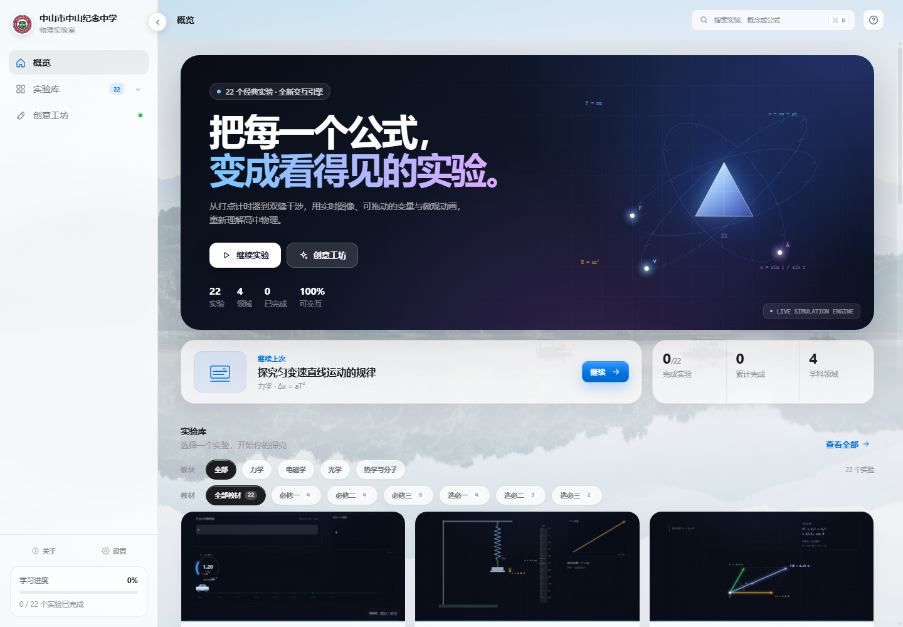

# Prism · 棱镜物理实验室

> 版本 **0.3.1** · 21 个高中物理实验 · 教材分类 · 可调节字体与主题 · 开放实验工坊

> 产品需求文档：[PRD.md](PRD.md)

> 0.3.1 修复：便携版不再等待浏览器进程退出，并使用独立浏览器配置目录，避免启动被误判为失败。

> `dist/` 中的 v0.3.1 EXE、便携 ZIP 与使用说明已随仓库一起提供。

> 把每一个公式，变成看得见的实验。

Prism 是一个面向高中物理的交互式实验平台。它把 **21 个高中物理基本实验** 做成可拖动、可采集数据、可生成图像的模拟器，并使用 Apple 风格的界面、深色实验舞台、实时读数与动画来呈现抽象的物理过程。

项目完全由 **HTML + CSS + JavaScript** 编写，不依赖后端、不需要安装 Node.js 或编译工具，双击即可运行。无需动态链接库，也不依赖外部 CDN。




---

## 快速启动

### 方式一：双击启动（推荐）

双击项目根目录的 **`start.bat`**。

它会：

1. 在 `127.0.0.1:4178` 启动一个轻量本地静态服务器；
2. 用 Chrome / Edge 的 **应用窗口模式** 打开实验室；
3. 关闭命令行窗口或按 `Ctrl + C` 停止服务。

> 如果 Chrome / Edge 不在默认路径，脚本会自动尝试系统默认浏览器。

### 方式二：在 VS Code 中启动

1. 用 VS Code 打开本文件夹（或双击 `prism-physics-lab.code-workspace`）；
2. 按 `Ctrl + Shift + B`，或运行任务 **“Prism: 启动实验室”**；
3. 浏览器会自动打开 `http://127.0.0.1:4178/`。

### 方式三：直接打开

直接双击 `index.html` 也能运行。由于浏览器对本地文件的存储策略不同，建议使用前两种方式以获得更稳定的学习进度记录。

### 方式四：便携 EXE（分享给其他人）

**`dist/PrismLab-0.3.1.exe`** 是单文件便携版，适用于 Windows 10 / 11：

1. 把 exe 复制到任意目录，双击运行；
2. 程序内置全部 HTML / CSS / JavaScript，不需要联网、不需要安装；
3. 自动尝试用 Chrome / Edge 的应用窗口打开，若未安装则交给默认浏览器；
4. 关闭浏览器后服务仍在系统托盘，右键 Prism 图标可重新打开或退出。

由于是未签名程序，Windows SmartScreen 可能提示“未知发布者”，选择“更多信息 → 仍要运行”即可。

重新构建便携版：

```powershell
powershell -ExecutionPolicy Bypass -File packaging\build-exe.ps1
```

构建脚本会压缩 Web 资源、嵌入图标和版本信息，输出到 `dist/`。

---

## 设置、字体与页面滚动

- 点击顶部右侧的 **齿轮按钮** 打开独立设置面板。
- **字体大小** 使用滑块调节，支持 **100%–150%**，同时作用于界面正文、实验读数、Canvas 画布标注和图表坐标轴文字，并自动保存。
- **明暗外观** 可切换浅色 / 深色；**界面主题** 可在 **Windows 风格**（默认）与 **macOS 简约** 之间选择。
- 首次打开软件时会显示 **Welcome** 向导，询问字体大小、明暗外观和主题偏好；之后可在设置中随时修改或重新查看。
- 页面主体支持鼠标滚轮上下滚动；鼠标位于侧边栏、画布或图表上时也可以滚动主内容。数据表内部滚动时优先滚动表格。
- 切换实验时会自动回到页面顶部，避免上一个实验的滚动位置遮挡新页面。

---

## 功能总览

- **21 个高中物理实验**：力学 10 个、电磁学 8 个、光学 2 个、热学与分子 1 个。
- **实时模拟**：Canvas 60fps 动画，可播放、暂停、重置、全屏、截图。
- **实时图像**：每个实验都有对应的物理量图像，如 v–t、F–x、a–F、U–I、T²–L、sin i–sin r 等。
- **数据探究**：调节变量 → 采集数据 → 自动生成散点、拟合线与数据表 → 导出 CSV。
- **实验向导**：步骤可勾选，结论随数据动态更新。
- **教材分类**：保留力学 / 电磁学 / 光学 / 热学与分子分类，同时增加粤教版必修一、必修二、必修三、选必一、选必二、选必三筛选。
- **电学 / 光学交互面板**：电路图、电表、变压器、双缝干涉、折射光路等以完整交互面板模拟。
- **多用电表接线互动**：7 种待测元件可选；拖动红黑表笔接触元件两端后才会显示读数，支持断线、错接和换挡提示。
- **抽象过程动画**：油膜铺展与单分子层、电磁感应、频闪轨迹、能量转化等。
- **创意工坊**：用变量和公式设计自己的实验，实时预览图像，发布到实验库。
- **开放接口**：通过 `OL.registerExperiment()` / `OL.registerPlugin()` 用 JavaScript 扩展新实验。
- **本地档案**：学习进度、实验步骤、自定义实验保存在 `localStorage`。
- **深色模式**、响应式布局、键盘快捷键、全局实验搜索。
- **字体与主题**：齿轮设置支持 100%–150% 字体滑块、浅色 / 深色、Windows / macOS 主题，并保存到本地。
- **顺滑滚轮浏览**：实验页、实验库与工坊均可用鼠标滚轮上下滚动；页面底部预留了充足空间，长内容不会被裁切。

---

## 21 个实验

| # | 实验 | 领域 | 核心图像 / 交互 |
|---|------|------|-----------------|
| 01 | 研究匀变速直线运动 | 力学 | 纸带点迹、v–t 图像 |
| 02 | 探究弹力与弹簧伸长量的关系 | 力学 | F–x 图像、胡克定律 |
| 03 | 验证力的平行四边形定则 | 力学 | 矢量合成、合力随夹角变化 |
| 04 | 探究加速度与力、质量的关系 | 力学 | a–F、a–1/m 控制变量 |
| 05 | 研究平抛运动 | 力学 | 频闪轨迹、运动分解 |
| 06 | 探究向心力的大小 | 力学 | F–r、F–ω² 图像 |
| 07 | 探究功与速度变化的关系 | 力学 | W–v² 图像、动能定理 |
| 08 | 验证机械能守恒定律 | 力学 | 动能 / 势能 / 总能量曲线 |
| 09 | 验证动量守恒定律 | 力学 | 碰撞前后 p–t 曲线 |
| 10 | 用单摆测量重力加速度 | 力学 | T²–L 图像、周期测量 |
| 11 | 测量金属丝的电阻率 | 电磁学 | 伏安法、U–I 图像 |
| 12 | 描绘小灯泡的伏安特性曲线 | 电磁学 | 非线性 I–U 曲线、灯丝温升 |
| 13 | 测量电源电动势和内阻 | 电磁学 | U–I 截距与斜率 |
| 14 | 练习使用多用电表 | 电磁学 | 挡位、量程、表盘读数 |
| 15 | 探究安培力的大小 | 电磁学 | F–I 图像、左手定则 |
| 16 | 探究电磁感应的产生条件 | 电磁学 | 磁铁运动、电流计指针 |
| 17 | 探究变压器电压与匝数的关系 | 电磁学 | U₂–n₂ 图像、交流波形 |
| 18 | 探究平行板电容器的电容 | 电磁学 | C–d、C–S 图像、电场线 |
| 19 | 测量玻璃的折射率 | 光学 | sin i–sin r 图像、光路 |
| 20 | 用双缝干涉测光的波长 | 光学 | 干涉条纹、强度分布 |
| 21 | 用油膜法估测分子的大小 | 热学与分子 | 油膜铺展动画、单分子层 |

---

## 创意工坊

### 可视化设计

打开左侧 **创意工坊**，填写：

- 实验名称、简介、主题色；
- 函数表达式，例如 `a * sin(t) + b`；
- 自变量 `t` 的范围与步长；
- 参数 `a`、`b` 的名称、范围与单位；
- 纵轴名称与单位。

右侧会实时预览函数曲线。点击 **“创建并打开实验”** 后，会生成一个完整的实验页，包含变量滑块、实时读数、图像、数据表与实验向导。

支持的表达式：

```text
+  -  *  /  ^  ( )
sin cos tan asin acos atan
sqrt abs exp ln log log2
floor ceil round min max pow
sind cosd tand          # 角度制三角函数
pi e tau
```

### 导入 / 导出

- **导出全部**：生成 `prism-custom-experiments.json`；
- **导入 JSON**：支持单个对象、数组或 `{ "experiments": [...] }`；
- 也可直接加载本地 `.js` 插件文件。

---

## 开放实验接口

在页面加载后，可以通过全局对象 `OL` 注册新实验。

### 1. 注册一个完整实验

```js
OL.registerExperiment({
  id: 'damped-oscillation',
  title: '阻尼振动',
  description: '观察振幅随时间的衰减。',
  formula: 'x = A e^(-γt) cos(ωt)',
  accent: '#5e5ce6',
  controls: [
    { key: 'A', label: '初始振幅 A', min: 0.1, max: 5, step: 0.1, value: 2, unit: 'cm', decimals: 2 },
    { key: 'gamma', label: '阻尼系数 γ', min: 0, max: 1, step: 0.01, value: 0.1, unit: '', decimals: 2 },
    { key: 'omega', label: '角频率 ω', min: 0.5, max: 5, step: 0.1, value: 2, unit: 'rad/s', decimals: 1 }
  ],
  lab: {
    draw(ctx, w, h, state, view) {
      // 使用 Canvas 2D 绘制实验场景
    },
    readouts(state) {
      return [
        { label: '位移 x', value: '1.20', unit: 'cm' },
        { label: '振幅 A', value: '2.00', unit: 'cm' }
      ];
    },
    plot(state, view) {
      return {
        xLabel: '时间 t', yLabel: '位移 x', xUnit: 's', yUnit: 'cm',
        series: [{ name: 'x–t', color: '#5e5ce6', points: [{ x: 0, y: 2 }, { x: 1, y: 1 }] }]
      };
    },
    sample(state) {
      return { t: 0, x: 1.2 };
    },
    columns: [
      { key: 't', label: 't', unit: 's', decimals: 2 },
      { key: 'x', label: 'x', unit: 'cm', decimals: 2 }
    ],
    conclusion(state) {
      return '<b>结论：</b>振幅随时间指数衰减。';
    }
  }
});
```

`lab` 对象可实现的钩子：

| 钩子 | 说明 |
|------|------|
| `init(state, view)` | 初始化内部状态 |
| `onControl(key, state, view)` | 变量改变时调用 |
| `step(state, dt, view)` | 播放时每帧更新物理状态 |
| `draw(ctx, w, h, state, view)` | 绘制实验舞台，坐标为 CSS 像素 |
| `readouts(state, view)` | 返回 `{label, value, unit}` 数组 |
| `sample(state, view)` | 返回一行数据，供数据表与 CSV 使用 |
| `columns` | 数据表列定义 |
| `plot(state, view)` | 返回 `{xLabel, yLabel, xUnit, yUnit, series}` |
| `conclusion(state, view)` | 返回结论 HTML |

`view` 提供：

```js
view.t         // 播放时间
view.playing   // 是否正在播放
view.records   // 已采集的数据
```

### 2. 批量注册插件

```js
OL.registerPlugin({
  name: '我的实验包',
  version: '1.0.0',
  experiments: [ /* 多个 OL.registerExperiment 配置 */ ]
});
```

### 3. 公式型实验

```js
OL.workshop.add({
  name: '平方反比关系',
  description: '验证 y 与 t² 的关系。',
  expression: 'a / (t^2 + b)',
  yLabel: '强度', yUnit: 'lx',
  tLabel: '距离', tUnit: 'm',
  tMin: 0.5, tMax: 5, tStep: 0.01, tValue: 2,
  aLabel: '系数 a', aMin: 0.1, aMax: 10, aStep: 0.1, aValue: 5, aUnit: '',
  bLabel: '偏移 b', bMin: 0, bMax: 3, bStep: 0.1, bValue: 0.5, bUnit: '',
  accent: '#0a84ff'
});
```

---

## 项目结构

```text
prism-physics-lab/
├─ index.html                    # 应用外壳
├─ start.bat                     # 一键启动
├─ run.ps1                       # 本地静态服务器 + 浏览器启动
├─ assets/
│  ├─ css/
│  │  └─ styles.css              # Apple 风格设计系统、响应式布局
│  └─ js/
│     ├─ data.js                 # 21 个实验元数据、步骤、控件
│     ├─ app.js                  # 路由、仪表盘、实验运行时
│     ├─ workshop.js             # 创意工坊
│     ├─ plugin-api.js           # 开放实验接口
│     ├─ core/
│     │  ├─ utils.js             # 工具、Canvas 绘图助手、本地存储
│     │  ├─ chart.js             # 交互式 Canvas 图表引擎
│     │  └─ expr.js              # 安全表达式编译器（工坊用）
│     └─ labs/
│        ├─ common.js            # 实验公共绘图能力
│        ├─ mechanics-a.js       # 01–05
│        ├─ mechanics-b.js       # 06–10
│        ├─ electricity-a.js     # 11–14
│        ├─ electricity-b.js     # 15–18
│        └─ optics-molecular.js  # 19–21
└─ .vscode/                      # 推荐扩展与启动任务
```

---

## 键盘快捷键

| 快捷键 | 功能 |
|--------|------|
| `⌘ / Ctrl + K` | 全局搜索实验 |
| `Space` | 播放 / 暂停当前实验 |
| `R` | 重置实验 |
| `F` | 全屏实验舞台 |
| `Esc` | 关闭弹窗 / 搜索 |

---

## 设计说明与教学边界

为了在浏览器中保持流畅与可交互，部分实验采用教学化近似模型：

- 小灯泡的 `I–U` 曲线使用随电压升温的电阻模型，用于呈现“非线性”趋势；
- 变压器按理想变压器处理，忽略漏磁、铜损与铁损；
- 油膜法把油酸膜视为理想单分子层，面积由用户给定或由动画示意；
- 平抛、单摆、碰撞等实验采用高中阶段的标准理想模型，重力加速度可调节；
- 电磁感应图像使用磁通量变化率模型，用于定性/半定量观察。

这些近似不影响实验的核心物理规律与图像趋势，但不应作为精密测量数据使用。

---

## 浏览器支持

- Chrome / Edge 96+
- Safari 16+
- Firefox 110+

使用了 `Canvas 2D`、`ResizeObserver`、`backdrop-filter` 与 `localStorage`。不支持 `backdrop-filter` 的浏览器会自动退化为普通半透明面板。

---

## License

本项目为教学演示项目，可自由用于课堂、社团与个人学习。第三方字体与图标均使用系统字体 / 内联 SVG，无外部资源依赖。
